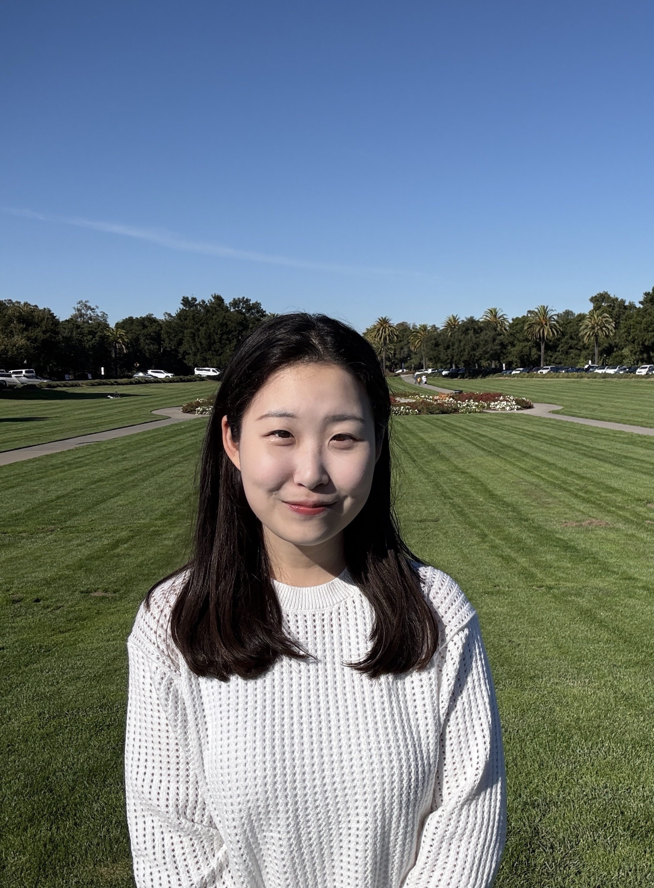

  

    
    
sohyeon@stanford.edu sohyeon.kim@vision.snu.ac.kr

    

      <a href="https://github.com/ohmyksh" style="text-decoration:none;">Github</a>
      <a href="https://scholar.google.com/citations?user=Oe6wbtMAAAAJ&hl=en" style="text-decoration:none;">Scholar</a>
      <a href="https://www.linkedin.com/in/kimsohyeon/" style="text-decoration:none;">LinkedIn</a>
      <a href="https://x.com/ohmyksh?s=21" style="text-decoration:none;">X</a>
      <a href="{{ '/blog/' | relative_url }}" style="text-decoration:none;">Blog</a>
    

  

  

 I am a visiting researcher at Stanford University, working with Prof. <a href="https://ai.stanford.edu/~cbfinn/" style="color:#0E8C8C; font-weight:450;">Chelsea Finn</a>. I am also a second-year PhD student at Seoul National University, advised by Prof. <a href="https://vision.snu.ac.kr/gunhee/" style="color:#0E8C8C; font-weight:450;">Gunhee Kim</a>.

  I have always been drawn to what I know, what I do not, and how to explore the gap between them. This leads me to ask how models can use external knowledge to solve increasingly challenging problems. I believe we already have plenty of knowledge to draw on, especially the knowledge that keeps evolving and accumulating. We need memory systems that models can manage on their own, so they can reuse prior knowledge instead of reasoning from scratch and avoid repeating past failures.

  Retrieving such knowledge is hard with existing methods, since it rarely looks similar on the surface. Still, humans (especially domain experts) intuitively know where to look in a vast search space and find connections that seem obvious only in hindsight, a kind of research taste explored in <a href="{{ '/project/ScholarCatalyst/' | relative_url }}" style="color:#0E8C8C; font-weight:450;">ScholarCatalyst</a>. I aim to build models that find such connections for better decision making in open-ended, long-horizon problems.

  I enjoy thinking and reading about research and beyond. You can find my thoughts on my <a href="{{ '/blog/' | relative_url }}" style="color:#0E8C8C; font-weight:450;">Blog</a> and <a href="{{ '/philosophy/' | relative_url }}" style="color:#0E8C8C; font-weight:450;">Research Philosophy</a>.

  

### Research

  

  
  

  <a href="https://ai.stanford.edu/blog/scholarcatalyst/" style="color:#000; font-weight:500">Research Intuition as a Retrieval Task</a> 
  Sohyeon Kim and Yoonho Lee 
  November 2026&nbsp;&nbsp;<a href="https://ai.stanford.edu/blog/scholarcatalyst/" style="color:#0E8C8C; font-weight:450;">SAIL Blog Post</a>
  

  

  

  ScholarCatalyst: A Benchmark for Retrieving Papers that Inspire New Research
  

  Sohyeon Kim*, Yoonho Lee*, Bo Liu, Dayoon Ko, Rulin Shao, Seungone Kim, Graham Neubig, Pang Wei Koh, Aakanksha Chowdhery, Akari Asai, Omar Khattab, Yejin Choi, Gunhee Kim, Chelsea Finn 
  Preprint 2026&nbsp;&nbsp;<a href="{{ '/project/ScholarCatalyst/' | relative_url }}" style="color:#0E8C8C; font-weight:450;">Website</a>&nbsp;&nbsp;<a href="https://arxiv.org/abs/2610.02202" style="color:#0E8C8C; font-weight:450;">Paper</a>&nbsp;&nbsp;<a href="https://github.com/stanford-iris-lab/ScholarCatalyst" style="color:#0E8C8C; font-weight:450;">Code</a>&nbsp;&nbsp;<a href="https://huggingface.co/ScholarCatalyst" style="color:#0E8C8C; font-weight:450;">Data</a>&nbsp;&nbsp;*equal contribution 
  Selected for Laude Institute's <a href="https://www.laude.org/updates/slingshots-four" style="color:#0E8C8C; font-weight:450;">Slingshots // FOUR</a>

<figure class="scholarcatalyst-figure" style="margin:14px 0 52px 0; display:flex; align-items:center; gap:14px;">
  
  
</figure>

  

  MULTI3IR: A Benchmark for Multi-perspective Multi-domain Multi-modal Information Retrieval
  

  Seokwon Song, Sohyeon Kim, Gunhee Kim 
  EMNLP 2026&nbsp;&nbsp;<a href="https://arxiv.org/pdf/2608.30949" style="color:#0E8C8C; font-weight:450;">Paper</a>

  

  When Is Enough Not Enough? Illusory Completion in Search Agents
  

  Dayoon Ko, Jihyuk Kim, Sohyeon Kim, Haeju Park, Dahyun Lee, Gunhee Kim, Moontae Lee, Kyungjae Lee 
  <a href="https://www.aiagentbehavior.com/" style="color:#000;">COLM 2026 Workshop on Agent Behavior</a>&nbsp;&nbsp;<a href="https://arxiv.org/pdf/2602.07549" style="color:#0E8C8C; font-weight:450;">Paper</a>

  

  Hybrid Deep Searcher: Scalable Parallel and Sequential Search Reasoning
  

  Dayoon Ko, Jihyuk Kim, Haeju Park, Sohyeon Kim, Dahyun Lee, Yongrae Jo, Gunhee Kim, Moontae Lee, Kyungjae Lee 
  ICLR 2026&nbsp;&nbsp;<a href="https://openreview.net/pdf?id=rXpTZyucal" style="color:#0E8C8C; font-weight:450;">Paper</a>&nbsp;&nbsp;<a href="https://hybriddeepsearcher.github.io/" style="color:#0E8C8C; font-weight:450;">Website</a>

  

  When Should Dense Retrievers Be Updated in Evolving Corpora? Detecting Out-of-Distribution Corpora Using GradNormIR
  

  Dayoon Ko, Jinyoung Kim, Sohyeon Kim, Jinhyuk Kim, Jaehoon Lee, Seonghak Song, Minyoung Lee, Gunhee Kim 
  ACL 2025 Findings&nbsp;&nbsp;<a href="https://arxiv.org/abs/2506.01877" style="color:#0E8C8C; font-weight:450;">Paper</a>

